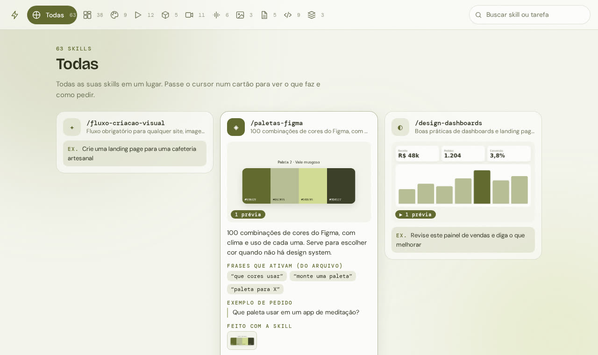
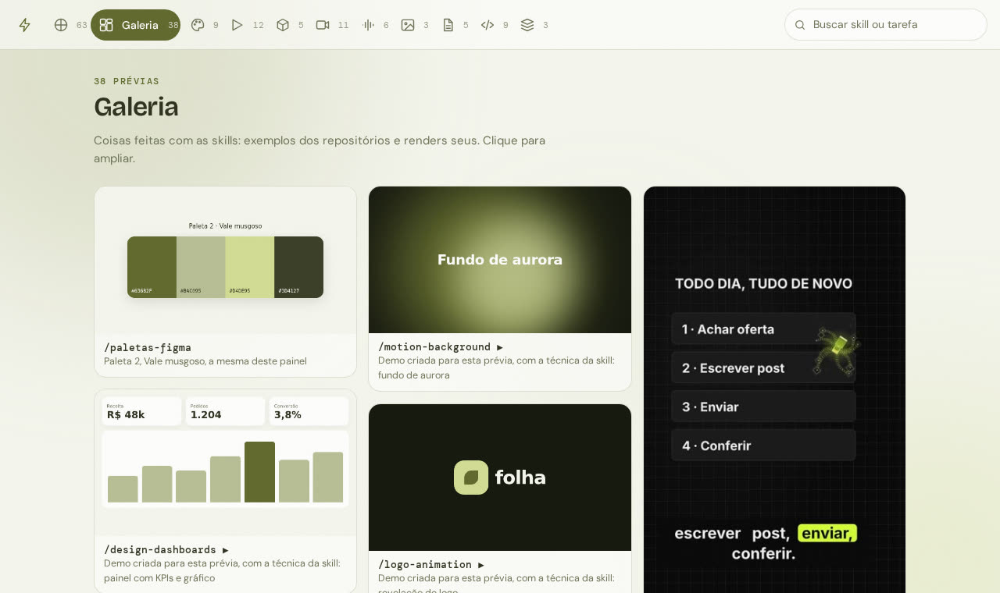
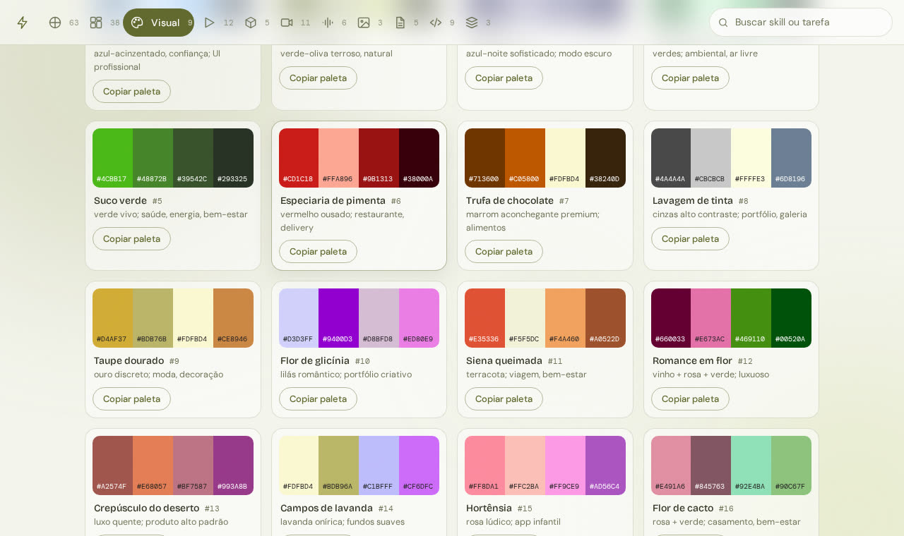

# painel-de-skills

Skill do [Claude Code](https://code.claude.com/docs/en/skills) que gera um painel (uma página HTML) com as skills que você tem instaladas: categorias, busca, descrição, exemplo de pedido e botões para copiar o comando. Dá para abrir dentro do Claude publicando como Artifact.

Este repositório contém só a skill que cria o painel. Nenhuma das skills listadas vai junto: o gerador apenas lê os `SKILL.md` da sua máquina.

## Como fica

Capturas do painel com 63 skills curadas (resumos em português, prévias e catálogos), que usam as opções `--overrides` e `--previews`.







## Instalação

```bash
git clone https://github.com/dcamk/painel-de-skills.git
cp -r painel-de-skills/painel-de-skills ~/.claude/skills/
```

## Uso

No Claude Code: "faça um painel das minhas skills". Ou direto:

```bash
python3 ~/.claude/skills/painel-de-skills/scripts/build_panel.py --out painel-skills.html
```

Opções (categorias, resumos em português, galeria de prévias e catálogos): veja `painel-de-skills/SKILL.md` e `painel-de-skills/references/personalizar.md`.

## Limites

- Sem ajustes, as descrições e os exemplos vêm do próprio arquivo de cada skill e podem estar em inglês. As categorias são deduzidas por palavras-chave; use `--overrides` para corrigir.
- Sem `--overrides` e `--previews`, o painel é mais simples que nas capturas: sem galeria, sem catálogos e com textos tirados do arquivo de cada skill.
- As capturas mostram nomes e descrições de skills de terceiros apenas como imagem; nenhuma skill é distribuída aqui.

## Licença

MIT.
